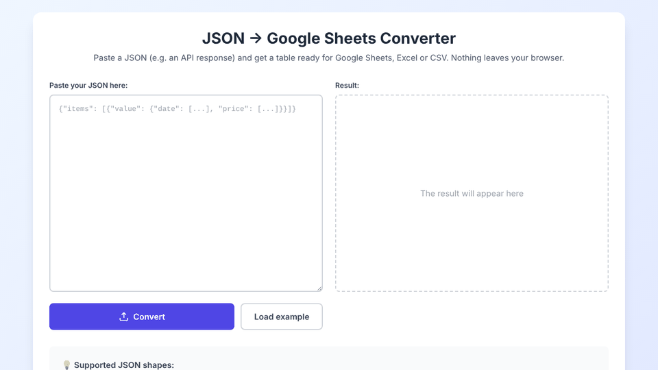

# JSON → Sheets


A small browser tool that turns JSON — typically an API response — into a table you can paste into Google Sheets or Excel, or download as CSV.

**Live demo:** https://Revvy1786.github.io/json-to-sheets/



## The problem

When troubleshooting SaaS integrations (PMS, channel managers, pricing APIs) I often get responses like this:

```json
{ "date": ["2024-03-25", "2024-03-26"], "price": [100, 150], "roomId": [101, 101] }
```

The data is stored *by column*: three parallel arrays. To compare values, spot gaps or share findings with a colleague, I need it *by row*, in a spreadsheet. Doing that by hand is slow and error-prone, so I built this tool.

## How to use it

1. Open the [live demo](https://Revvy1786.github.io/json-to-sheets/), or `index.html` locally — no install needed.
2. Paste your JSON, or click **Load example**.
3. Click **Convert**.
4. **Copy for Sheets** → select cell A1 in Google Sheets → paste. Or **Download CSV**.

Everything runs in the browser: the JSON is never sent anywhere.

## Supported input

| Shape | Example | Result |
|---|---|---|
| Parallel arrays | `{"date": [...], "price": [...]}` | element *i* of every array → row *i* |
| Array of objects | `[{"date": "...", "price": 1}, ...]` | one row per object |
| Wrapped in `items[].value` or `value` | `{"items": [{"value": {...}}]}` | every item is read; an `item` column shows where each row comes from |

Nested objects are flattened into dotted columns (`guest.country`). Non-array fields next to parallel arrays (`metadata`, `status`, …) are ignored.

### Example

Input ([`examples/rate-calendar.json`](examples/rate-calendar.json)):

```json
{
  "metadata": { "source": "demo-rates-api" },
  "items": [
    { "value": { "date": ["2024-03-25", "2024-03-26", "2024-03-27"], "price": [100, 150, 135.5], "roomId": [101, 101, 101] } },
    { "value": { "date": ["2024-03-25", "2024-03-26"], "price": [89, 95], "roomId": [202, 202] } }
  ]
}
```

Output ([`examples/rate-calendar.csv`](examples/rate-calendar.csv)):

| item | date | price | roomId |
|---|---|---|---|
| 0 | 2024-03-25 | 100 | 101 |
| 0 | 2024-03-26 | 150 | 101 |
| 0 | 2024-03-27 | 135.5 | 101 |
| 1 | 2024-03-25 | 89 | 202 |
| 1 | 2024-03-26 | 95 | 202 |

A second example with nested objects is in [`examples/bookings.json`](examples/bookings.json). All example data is fictional.

## Project structure

```
index.html              page layout (Tailwind CSS via CDN)
js/converter.js         conversion logic, no DOM — testable on its own
js/app.js               UI: reads input, draws the table, copy/download
tests/converter.test.js unit tests (Node built-in test runner)
examples/               sample input and expected output
.github/workflows/      runs the tests on every push
```

## Technical choices

- **Plain HTML + JavaScript, no build step.** It runs from a single folder and is hosted for free on GitHub Pages.
- **Logic separated from the UI.** `converter.js` only transforms data, so it can be tested with `node --test` without a browser.
- **No HTML injection.** Values from the JSON are written with `textContent`, never `innerHTML`, so a malicious string like `` is shown as text, not executed.
- **Spreadsheet-safe export.**
  - CSV fields with commas, quotes or newlines are quoted (RFC 4180).
  - A UTF-8 BOM makes Excel read accented characters correctly.
  - Text starting with `=`, `+`, `-` or `@` gets a leading `'`, so it isn't executed as a formula (CSV injection).
- **Clear errors.** Invalid JSON, arrays of different lengths and unsupported shapes produce a message that says what is wrong.

## Running the tests

Requires Node.js 18+.

```bash
node --test
```

## Limitations

- Arrays of objects *inside* a record (e.g. `rooms: [{...}, {...}]`) are not expanded into rows; they appear as JSON text in one cell.
- Only the first 500 rows are shown on screen; the copy and the CSV always contain everything.
- The CSV uses a comma separator. Excel with Italian or other European locale settings expects `;`, so the file may open in a single column. Google Sheets and "Copy for Sheets" are not affected.
- Tailwind is loaded from its CDN, which Tailwind recommends for prototypes rather than production. The page needs an internet connection for styling.

## Possible next steps

- Choice of CSV separator (`,` or `;`)
- Native `.xlsx` export
- Expand nested arrays of objects into rows
- Upload a `.json` file instead of pasting

## How it was built

The first version was generated with ChatGPT. I then had it reviewed with a second AI assistant (Claude) and checked each finding: HTML injection, hard-coded column names, only the first item being read, and broken CSV escaping. The fixes also separated the logic from the UI and added tests. The commit history shows each step: the original version, the fixes, then my own changes.

## License

[MIT](LICENSE)
